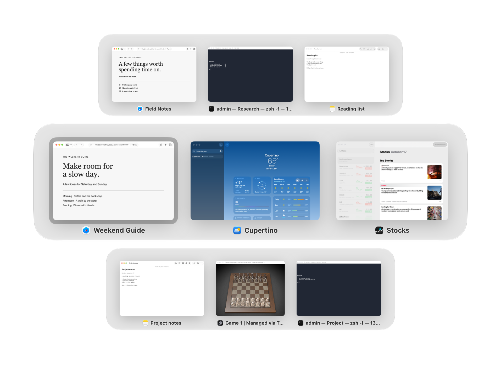
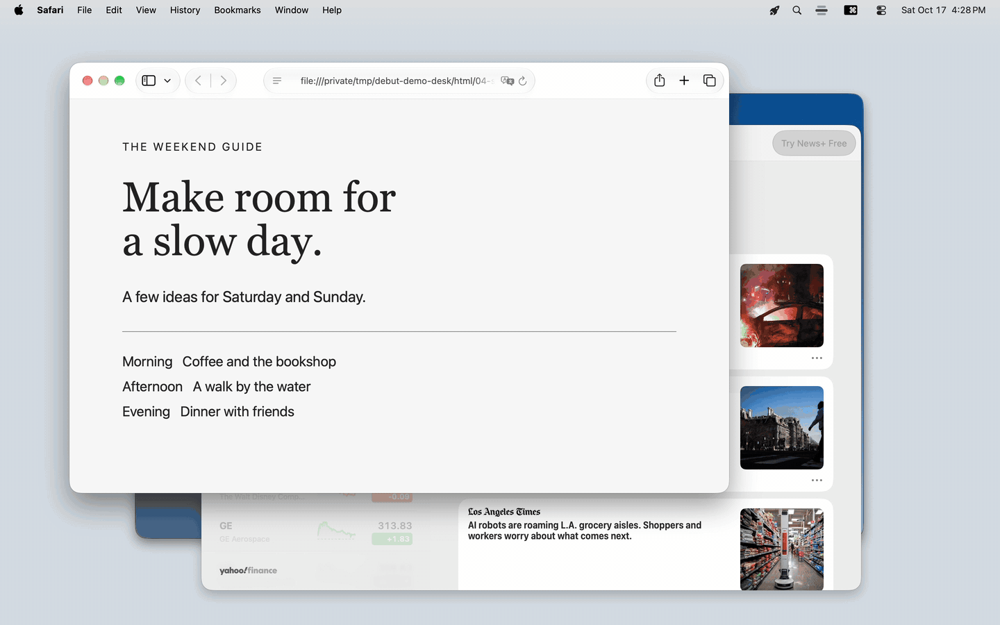

# Debut

Debut turns the macOS Command-Tab switcher into a workspace manager: window
previews grouped by space, window moves between spaces, and instant space switching.

[**Download Debut**](https://github.com/thomplth/debut/releases/latest) · macOS 26 or later (desktop management needs macOS 27) · Apple Silicon

<picture>
  <source media="(prefers-color-scheme: dark)" srcset="docs/media/overlay-dark.png">
  <source media="(prefers-color-scheme: light)" srcset="docs/media/overlay.png">
  
</picture>

Feature demos, the motivation behind Debut, and setup questions are on
[debutspace.com](https://debutspace.com/). This page is the reference.

## Keyboard

All defaults can be changed or disabled in **Settings › Shortcuts**.

### Global

| Shortcut | Action |
| --- | --- |
| **⌘ Tab** / **⌘ ⇧ Tab** | Open the switcher on the current space at the next / last window |
| **⌘ ⌥ Tab** / **⌘ ⌥ ⇧ Tab** or **⌘ ⌥ \`** | Open the switcher and cycle spaces forward / backward |
| **⌥ Tab** / **⌥ ⇧ Tab** | Open Option-Tab: every window on every space, most recent first |
| **⌃ 1–9** | Switch to space 1–9 |
| **⌃ ⌥ 1–9** | Switch to space 1–9 and focus the current app's window there |
| **⌘ ⌥ ←** or **⌘ ⌥ ↑** | Move the focused window to the previous space and follow it |
| **⌘ ⌥ →** or **⌘ ⌥ ↓** | Move the focused window to the next space and follow it |
| **⌃ ← / →**, trackpad swipe | macOS space switching, made faster or instant |

**⌘ \`** is left to macOS. The window-move chords require Command-Tab workspace
isolation.

### While the switcher is open

Keep the activation modifier held (Command for Command-Tab) and press:

| Key | Action |
| --- | --- |
| **Tab** / **⇧ Tab** or **\`** | Next / previous window in the selected space |
| **⌥ Tab** / **⌥ ⇧ Tab** | Next / previous space |
| **1–8**, **9** | Select space 1–8; 9 selects the last space |
| **H J K L** | Move the selector left, down, up, right |
| **↑ / ↓** | Move the selected window to the previous / next space |
| **← / →** | Move the selected window left / right within its space |
| Drag a preview | Move that window to another space |
| **Return** | Next display's spaces (multiple displays) |
| **W** | Close the selected window |
| **Q** | Quit the selected app |
| **N** | Add a desktop after the selected one (macOS 27) |
| **Delete** | Remove the selected desktop; its windows join the desktop showing, or a neighbour if it is the one showing (macOS 27) |
| Drag a space, **+** | Reorder desktops, drop one onto another to merge them, or add one at the top or bottom (macOS 27) |
| **Esc** | Close the switcher and discard staged changes |
| Release the modifier | Focus the selection and apply staged moves and desktop changes |

Option-Tab supports Tab, ⇧ Tab, \`, H J K L, W, Q and Esc. Space, move and desktop
keys are Command-Tab only.

## Settings

| Page | Contents |
| --- | --- |
| General | Launch at login, Dock icon, automatic crash reports, apps ignored by window management |
| Desktops | Faster switching for number keys, Control-arrows and trackpad swipes; transition duration (Instant to 400 ms); desktop-change indicator |
| Switcher | Command-Tab isolation, Option-Tab, window previews, overlay display, preview freshness, hold delay, held cycling pace |
| Appearance | Live preview, card layout and size, inactive-space scale, app icon placement, Liquid Glass, selection highlight; separate values with and without previews |
| Shortcuts | Every binding above, numbered-space modifiers, restore defaults |
| Support | Bug report form, diagnostic export, window-cache reset, settings reset |
| About | Version, update checks, links |

Fresh defaults and behavior details are in [settings and onboarding](spec/settings.md).

## Compatibility

| | macOS 26 | macOS 27 |
| --- | --- | --- |
| Command-Tab, Option-Tab, previews, window moves | Yes | Yes |
| Faster space switching (keys and trackpad) | Yes | Yes |
| Add, remove, reorder and merge desktops from the switcher | No | Yes |
| Fixed Liquid Glass tint | No (follows the system) | Yes |

Requires Apple Silicon. Features that depend on private macOS behavior stay off on
releases where it has not been measured, and macOS shortcuts pass through unchanged.

## Permissions

- **Accessibility** (required): shortcuts and window control.
- **Screen Recording** (optional): window previews. Without it, Debut shows app
  icons and titles.

Debut keeps its data on your Mac and sends crash reports only with permission. See
[privacy](docs/privacy.md).

## Build from source

See [contributing](CONTRIBUTING.md) for requirements, tests and
`./scripts/build-app.sh`.

## Credits

Option-Tab is inspired by Windows Alt-Tab and
[lwouis/alt-tab-macos](https://github.com/lwouis/alt-tab-macos). Faster space
switching builds on
[jurplel/InstantSpaceSwitcher](https://github.com/jurplel/InstantSpaceSwitcher),
[joshuarli/iss](https://github.com/joshuarli/iss), and
[Tahul/space-rabbit](https://github.com/Tahul/space-rabbit).

[Documentation](docs/README.md) · [Privacy](docs/privacy.md) · [GPL-3.0-only license](LICENSE)
